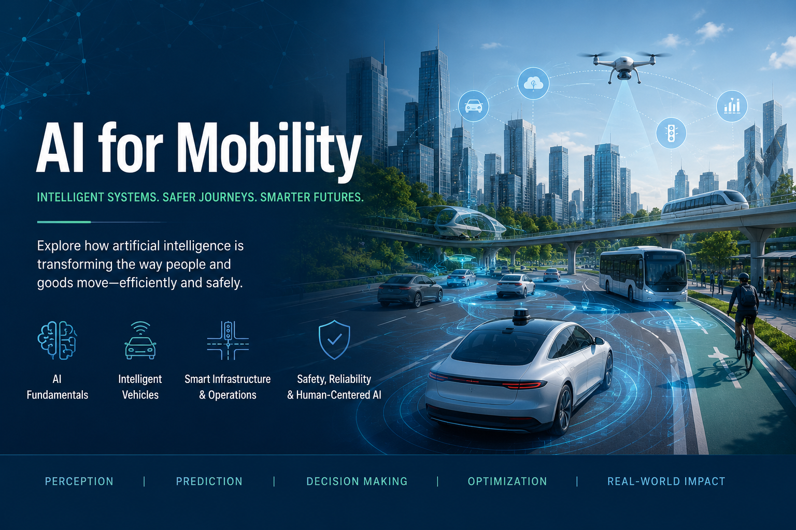

# AI for Mobility

Welcome to **AI for Mobility**, a graduate course at the University of South Florida on how modern AI
works and how to use it on transportation problems. Each method is taught through a transportation
example. You then run it yourself, in a lab notebook or an interactive page, and use it in a team
project on a real transportation problem. The materials are openly licensed, so anyone can follow along.

:::{admonition} Fall 2026 offering
:class: tip

**CGN 6933, Section 903** (CRN 85372) · Thursdays, 5:00–7:45 PM · NES 103\
First class Thursday, August 27, 2026

No prerequisites and no prior AI coursework required — open to graduate students across
engineering. Full details on the {doc}`syllabus` page.
:::

## What the Course Offers

Everything below is on this site and free to use, except the course dataset, which enrolled students
download from Canvas.

% Counts as of Oct 24, 2026. Update them when a notes section, companion, lab or device is added.
% Companions = HTML pages in _static/companions/ minus AI4Mobility_Intake_Survey.html.

<ul class="offer-stats" aria-label="The course in numbers">
  <li>8modules, from neural networks to AI agents</li>
  <li>30sections of course notes so far</li>
  <li>29interactive companion pages</li>
  <li>6lab notebooks, with 7 more in development</li>
  <li>8kinds of hardware you can borrow</li>
  <li>2,425hurricane posts with images in the course dataset</li>
</ul>

  <article class="resource-card">
    

Read

    <h3>Course notes</h3>
    
Written section by section, like a textbook. Each section first shows how a method works in a diagram, then gives the key equation in plain words. Extra math sits in optional &ldquo;Going deeper&rdquo; boxes.

    
Diagram firstTwo levels of math

    <a class="resource-link" href="module1/index.html">Start with Module 1</a>
  </article>
  <article class="resource-card">
    

Explore

    <h3>Interactive companions</h3>
    
Pages that run in your browser, with nothing to install. Change an input and watch what the model does. Many run a real model on real transportation data, such as Florida crash reports or Los Angeles freeway detectors.

    
Runs in the browserReal data

    <a class="resource-link" href="#try-a-companion">Try one</a>
  </article>
  <article class="resource-card">
    

Build

    <h3>Lab notebooks</h3>
    
Notebooks that run in Google Colab. Each one names the simpler method to compare against before you trust the result. Labs and notebook exercises are 40% of the course grade.

    
Google ColabOpen data

    <a class="resource-link" href="labs.html">All labs</a>
  </article>
  <article class="resource-card">
    

Build

    <h3>Hardware you can borrow</h3>
    
A Raspberry Pi 5 and two NVIDIA Jetson computers, camera kits, a desktop AI robot, and comma devices that run openpilot in a car. All equipment is provided by the instructor; projects never use personal vehicles.

    
Edge AIIn-vehicle

    <a class="resource-link" href="hardware.html">Hardware for Class</a>
  </article>
  <article class="resource-card">
    

Data

    <h3>Transportation data</h3>
    
The course dataset holds 2,425 posts about roads, bridges, evacuation and fuel from Hurricanes Helene and Milton, with 3,348 images. The notes and labs also use FL511 traffic cameras, NHTSA vehicle complaints, Florida crash reports and METR-LA freeway detectors. More open datasets are on the <a href="resources.html">Resources</a> page.

    
Florida dataText and images

    <a class="resource-link" href="hurricane-dataset.html">The hurricane dataset</a>
  </article>
  <article class="resource-card">
    

Part II

    <h3>AI agents for transportation</h3>
    
The last five lectures cover how AI agents work and how to build them for transportation work: reasoning, tools, memory, planning, evaluation, fine-tuning, human review, and full workflows for SUMO simulation and safety analysis.

    
Five lecturesResearch and agency practice

    <a class="resource-link" href="module5/index.html">Start Part II</a>
  </article>

## How the Course Teaches

  

    <h3>What can transportation add?</h3>
    
Each AI method is taught first in its general form, so it carries over to any field. Then comes the question this course keeps asking: what can transportation researchers and engineers add to make it work better? Traffic flow and safety theory, an agency's decades of procedures and lessons, and its data can each enter a model or an agent at specific points. Every such idea is tested against the general method, because domain knowledge only counts when it beats the version without it.

  

  

    <h3>Transportation examples first</h3>
    
You meet each AI idea through something you already know. The cell transmission model turns out to be a convolution, and later a graph neural network. Attention works like a signal controller deciding how much green each approach gets.

  

  

    <h3>A picture before an equation</h3>
    
Each section starts with a diagram of how the method works. Then comes one key equation, read out in words. Extra math for those who want it sits in optional boxes. There are no proofs.

  

  

    <h3>Real numbers from real runs</h3>
    
The numbers in the notes and companions come from models that were actually run, often on Florida data. Where a method fails, the page shows the failure instead of hiding it.

  

  

    <h3>Always check against a baseline</h3>
    
A new method is only better if it beats something simpler. Every lab names what to compare against, and most sections end by saying when to keep the classical method.

  

## Who This Course Is For

This course is designed for:

- **USF graduate students** in transportation engineering, civil engineering, computer science, electrical engineering, or related fields who want to understand how AI is reshaping mobility — and to build things with it.
- **Practicing transportation engineers** looking to add machine learning, computer vision, and AI-assisted workflows to their toolkit.
- **Self-learners** anywhere in the world who are curious about AI applications in driving, traffic monitoring, and simulation.

You'll get the most out of the course if you have basic Python familiarity and have seen a probability or linear algebra course at some point. Advanced programming experience is not required. See {doc}`prerequisites` for details.

**By the end of the course** you will be able to:

- Describe core AI concepts relevant to mobility systems — neural networks, representation learning, transformers, generative models, reinforcement learning, and agentic AI — and identify which mobility problems each is suited to.
- Apply AI tools, notebook-based exercises, and transportation datasets to structured mobility analysis and modeling tasks.
- Interpret model outputs and assess their relevance, limitations, and likely sources of error in transportation applications.
- Read AI-mobility research critically and summarize the problem setting, method, data, findings, and limitations.
- Develop a group project applying an AI method, AI-assisted workflow, or hardware-integrated prototype to a real transportation problem.
- Communicate methods, results, limitations, and practical implications in written and oral form.
- Reason about responsible use of human-in-the-loop AI in transportation: reliability, robustness, safety, privacy, interpretability, human oversight, and professional accountability.

## Learning Modules

The course has eight modules in two parts, plus a capstone project. Modules fill in as the term goes on:
each one gets course notes, interactive companions, readings, and lab notebooks that run in Google Colab,
and video lectures go up on YouTube as they are recorded. The order follows the week-by-week schedule on
the {doc}`syllabus` page, and every notebook in the course is listed on the {doc}`All Labs <labs>` page.

**Part I — AI foundations through a transportation lens**

| Module | Topic |
|---|---|
| {doc}`Week 1 <course-intro>` | Course Introduction |
| {doc}`Module 1 <module1/index>` | Foundations and Representation Learning |
| {doc}`Module 2 <module2/index>` | Transformers, LLMs, and Multimodal Models |
| {doc}`Module 3 <module3/index>` | A Unified View: Graph Neural Networks |
| {doc}`Module 4 <module4/index>` | Deep Generative Models: VAE, Diffusion, and World Models |

**Part II — AI agents for mobility**

| Module | Topic |
|---|---|
| {doc}`Module 5 <module5/index>` | Understanding AI Agents: Reasoning, Tool Calling, Skills, Memory, Planning, and Coordination |
| {doc}`Module 6 <module6/index>` | Making Agents Better: Evaluation and Fine-Tuning |
| {doc}`Module 7 <module7/index>` | Agents and People in an Agency |
| {doc}`Module 8 <module8/index>` | Building Transportation Harnesses |

Part II draws its examples from across transportation research and agency practice: traffic flow,
safety, operations, driving automation, infrastructure, EVs, transit and air mobility. Traffic simulation
with SUMO and transportation safety analysis each get a hands-on lab and a full workflow, and the unit
ends with harnesses built for transportation research and agency use.

(try-a-companion)=
## Try a Companion

Companions are interactive pages built into the course notes. Each one opens in a new tab and runs in
your browser, with nothing to install. Here are six to start with.

  <article class="resource-card">
    

Module 1 &middot; Section 1.3

    <h3>A traffic wave is a convolution</h3>
    
Newell&rsquo;s car-following rule and the cell transmission model each turn out to be a convolution. A small network with 1,217 weights learns the traffic update live in your browser. Read it in context in <a href="module1/notes3-cnn.html">section 1.3</a>.

    
Traffic flowCNN

    <a class="resource-link" href="_static/companions/Newell_LWR_CNN_Companion.html" target="_blank" rel="noopener">Open the companion</a>
  </article>
  <article class="resource-card">
    

Module 1 &middot; Section 1.3

    <h3>A child on a scooter, seen by a stock detector</h3>
    
Thirteen seconds of forward-camera video from a car driving on Tesla FSD in Florida. An off-the-shelf detector labels every frame, and gets four things wrong that matter. Read it in context in <a href="module1/notes3-cnn.html">section 1.3</a>.

    
ADASObject detection

    <a class="resource-link" href="_static/companions/Scooter_Kid_CNN_Case.html" target="_blank" rel="noopener">Open the companion</a>
  </article>
  <article class="resource-card">
    

Module 2 &middot; Section 2.1

    <h3>Tokens: what a language model reads</h3>
    
A real GPT tokenizer runs in your browser on any text you type, from a crash narrative to the Signal Timing Manual. See why a model splits transportation words the way it does. Read it in context in <a href="module2/notes1-tokens.html">section 2.1</a>.

    
Language modelsTokenization

    <a class="resource-link" href="_static/companions/Tokenization_Companion.html" target="_blank" rel="noopener">Open the companion</a>
  </article>
  <article class="resource-card">
    

Module 2 &middot; Section 2.6

    <h3>A transformer on freeway detectors</h3>
    
Take the language out of a transformer and point it at 207 loop detectors on Los Angeles freeways (METR-LA). The same machine works once you decide what your tokens are. Read it in context in <a href="module2/notes6-architecture.html">section 2.6</a>.

    
Traffic sensingTransformers

    <a class="resource-link" href="_static/companions/Transformer_As_Architecture_Companion.html" target="_blank" rel="noopener">Open the companion</a>
  </article>
  <article class="resource-card">
    

Module 2 &middot; Section 2.13

    <h3>Does BERT earn its keep on crash reports?</h3>
    
Eight things people claim a language model can do with crash reports, each tested on 399 real Florida crash narratives and compared with the classical method it would replace. Read it in context in <a href="module2/notes13-evaluation.html">section 2.13</a>.

    
Road safetyBERT

    <a class="resource-link" href="_static/companions/Crash_Narrative_BERT_Companion.html" target="_blank" rel="noopener">Open the companion</a>
  </article>
  <article class="resource-card">
    

Module 3 &middot; Section 3.6

    <h3>A graph neural network on a road network</h3>
    
Generate a street network in your browser and watch one shared rule run at every intersection, and how a rule that only looks one hop away ends up modelling a disturbance that travels for miles. Read it in context in <a href="module3/notes6-message-passing.html">section 3.6</a>.

    
Road networksGNN

    <a class="resource-link" href="_static/companions/GNN_On_A_Road_Network_Companion.html" target="_blank" rel="noopener">Open the companion</a>
  </article>

## The Capstone Project

The {doc}`capstone/index` is a team project that starts in Week 1 and runs all term. It is half the
course grade: 20% for the proposal and progress updates, and 30% for the final product, report, and
presentation. Teams settled their topics by Sept 17, and final presentations and demos are on Dec 3.

Every project follows the same path, from a real need to a result other people can reuse.

<ol class="workflow-pipeline" aria-label="The path of a course project — five steps">

<li class="workflow-pipeline-step">

1

<h4>A Real Mobility Need</h4>

Start from a problem someone in transportation actually has.

</li>

<li class="workflow-pipeline-step">

2

<h4>Problem Translation</h4>

Turn it into a question an AI method can answer, with data you can get.

</li>

<li class="workflow-pipeline-step">

3

<h4>AI Methods &amp; Prototypes</h4>

Try vision, language models, simulation, edge AI, or an agent.

</li>

<li class="workflow-pipeline-step">

4

<h4>Baselines &amp; Peer Review</h4>

Beat a simpler method, and answer questions from classmates.

</li>

<li class="workflow-pipeline-step">

5

<h4>Open Results</h4>

Share code, notebooks, and a short report others can build on.

</li>

</ol>

### Projects This Term

Fall 2026 teams are working on:

  Building and structure damage detection
  Post-storm road damage inspection from AI dashcams, with automatic reports
  Pedestrian safety around self-driving cars
  Pavement distress detection
  An AI workflow for SUMO traffic simulation
  Safety analysis of agency data with BERT

Finished projects will be posted here after the Dec 3 presentations, each with a short problem brief,
the methods, the results, and what the team learned.

### Open Mobility Challenges

Not sure what a good project looks like? These five problems are the kind transportation agencies deal
with every day. Each is a reasonable starting point for a project, as long as you can get the data.

<article class="challenge-card">
<header class="challenge-card-header">
<h4>AI-Assisted Traffic Camera Monitoring</h4>
Example Challenge
</header>
<dl class="challenge-meta">
<dt>Operational context</dt>
<dd>TMC operators monitor many video feeds manually.</dd>
<dt>Possible AI direction</dt>
<dd>Computer vision and vision-language models for incident detection, queue monitoring, and event summarization.</dd>
<dt>Considerations</dt>
<dd>Camera access, false alarms, privacy, operator trust.</dd>
</dl>
<a class="challenge-link" href="https://github.com/ai4mobility/ai4mobility.github.io/issues" target="_blank" rel="noopener" aria-label="Discuss AI-Assisted Traffic Camera Monitoring on GitHub">Discuss on GitHub →</a>
</article>

<article class="challenge-card">
<header class="challenge-card-header">
<h4>Post-Storm Roadway Damage Assessment</h4>
Example Challenge
</header>
<dl class="challenge-meta">
<dt>Operational context</dt>
<dd>Agencies need rapid situational awareness after hurricanes or severe storms.</dd>
<dt>Possible AI direction</dt>
<dd>AI dashcam or drone-based detection of debris, flooding, damaged signs, blocked lanes, and signal outages.</dd>
<dt>Considerations</dt>
<dd>GPS tagging, offline operation, integration with existing reporting workflows.</dd>
</dl>
<a class="challenge-link" href="https://github.com/ai4mobility/ai4mobility.github.io/issues" target="_blank" rel="noopener" aria-label="Discuss Post-Storm Roadway Damage Assessment on GitHub">Discuss on GitHub →</a>
</article>

<article class="challenge-card">
<header class="challenge-card-header">
<h4>Near-Miss and Conflict Analysis</h4>
Example Challenge
</header>
<dl class="challenge-meta">
<dt>Operational context</dt>
<dd>Safety risks often appear before crashes but are difficult to measure systematically.</dd>
<dt>Possible AI direction</dt>
<dd>Video analytics, trajectory extraction, behavior recognition, and surrogate safety metrics.</dd>
<dt>Considerations</dt>
<dd>Camera placement, calibration, data quality, validation.</dd>
</dl>
<a class="challenge-link" href="https://github.com/ai4mobility/ai4mobility.github.io/issues" target="_blank" rel="noopener" aria-label="Discuss Near-Miss and Conflict Analysis on GitHub">Discuss on GitHub →</a>
</article>

<article class="challenge-card">
<header class="challenge-card-header">
<h4>Signal Operations and Anomaly Detection</h4>
Example Challenge
</header>
<dl class="challenge-meta">
<dt>Operational context</dt>
<dd>Signal timing issues, detector failures, and unusual congestion patterns can be hard to diagnose quickly.</dd>
<dt>Possible AI direction</dt>
<dd>Time-series anomaly detection, traffic state prediction, and AI-assisted diagnostic reports.</dd>
<dt>Considerations</dt>
<dd>Signal logs, detector data, probe data, interpretability.</dd>
</dl>
<a class="challenge-link" href="https://github.com/ai4mobility/ai4mobility.github.io/issues" target="_blank" rel="noopener" aria-label="Discuss Signal Operations and Anomaly Detection on GitHub">Discuss on GitHub →</a>
</article>

<article class="challenge-card">
<header class="challenge-card-header">
<h4>Work Zone Safety Monitoring</h4>
Example Challenge
</header>
<dl class="challenge-meta">
<dt>Operational context</dt>
<dd>Agencies need better awareness of risky interactions between vehicles, workers, and temporary traffic control.</dd>
<dt>Possible AI direction</dt>
<dd>Real-time object detection, intrusion detection, and safety alerting.</dd>
<dt>Considerations</dt>
<dd>Edge computing, low-light conditions, false positive management.</dd>
</dl>
<a class="challenge-link" href="https://github.com/ai4mobility/ai4mobility.github.io/issues" target="_blank" rel="noopener" aria-label="Discuss Work Zone Safety Monitoring on GitHub">Discuss on GitHub →</a>
</article>

Know a problem like these? <a href="https://github.com/ai4mobility/ai4mobility.github.io/issues" target="_blank" rel="noopener">Post it as a GitHub issue</a>.

## How to Use This Site

- **New here?** Read {doc}`course-intro` for why the course is shaped the way it is, then {doc}`prerequisites`.
- **Reading in order?** Move through the modules from the left sidebar, which keeps your place.
- **Looking up a topic?** Use the search box at the top of the sidebar. It covers every page.
- **Want to run a lab?** Click the rocket icon at the top of any notebook page and choose "Colab" to open it in your browser. No local setup is needed.

## Instructor and Contact

**Hao Zhou** is an Assistant Professor of Transportation Engineering at the University of South Florida. His research covers traffic flow theory, vehicle technologies (ADAS, lane-keeping assist, EVs), and AI for mobility, including AI dash cameras for traffic monitoring and road hazard detection.

- Email: [haozhou1@usf.edu](mailto:haozhou1@usf.edu)
- Video lectures: [YouTube — @hao6247](https://www.youtube.com/@hao6247)
- Course site: [ai4mobility.github.io](https://ai4mobility.github.io)

Questions about the course, or a mistake you spotted in the materials? Send an email or open a
[GitHub issue](https://github.com/ai4mobility/ai4mobility.github.io/issues).

## License

Course materials are released under the [Creative Commons Attribution 4.0 License](https://creativecommons.org/licenses/by/4.0/) — you're free to use, adapt, and share with attribution. See `LICENSE.md` in the repository for details.
